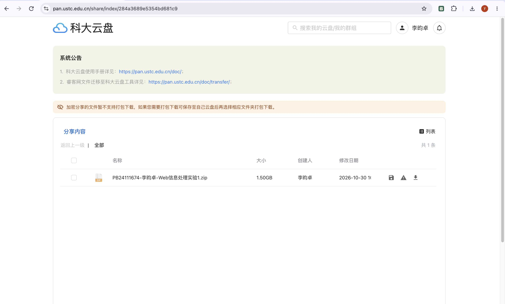

# web信息处理与应用 实验一

#### 小组成员：李昀卓 PB24111674；邓刚 JL25112401；徐子睿 PB24111670  

2026-10-28

## 数据与实验设置

使用课程提供的Qilin-IR-50k文档，共50000篇。

| 项目 | 实测规模 |
| --- | --- |
| 文档 | 50000 |
| 查询 | 1941 |
| 搜索曝光记录 | 18763 |
| 搜索训练 / 测试请求 | 1,471 / 470 |
| 正文平均 / 中位字符数 | 286.019 / 176.0 |
| 正文最大字符数 | 2361 |

## 分词与规范化

### 分词

1. 正向最大匹配 使用 Jieba 词典，优先处理英文与数字串，然后选择当前能匹配的最长词进行匹配。

2. 逆向最大匹配 同样使用 Jieba 词典，从原文末尾开始选择最长词进行匹配。倒序文本只用于识别右侧英文与数字串，并将匹配出的串恢复为原顺序；中文匹配始终使用原文切片。找到的词从后向前加入结果数组，最后翻转数组，恢复原文词序。

3. 统计法 使用 Jieba 词典提供的基于词频的DAG最优路径，并用HMM处理未登录中文词。

### 规范化

规范化依次进行 HTML 实体解析、Unicode NFKC、英文小写、去除小红书 [话题] 标记；丢弃仅由标点或表情组成的词项；纯数字词项映射为 `<num>`，其余词项保留。停用词采用 resources/stopwords.txt 中的自定义完整词项表，共 91 项，保留“不、没、无、未”等否定词。

### 分词结果

| 分词方法 | 保留词项数 | 去停用词后词项数 | 保留词表大小 | 分词秒数 |
| --- | --- | --- | --- | --- |
| FMM | 6400836 | 5218315 | 124758 | 14.915 |
| RMM | 6400042 | 5222415 | 124282 | 12.442 |
| Jieba 统计 | 6048962 | 4878129 | 201825 | 16.057 |

分词秒数包含规范化、切分、数值词项映射和位置生成。

| 比较方法 | 词项列表不同的字段数 | 差异比例 |
| --- | --- | --- |
| FMM / RMM | 44255 | 44.26% |
| FMM / Jieba 统计 | 70915 | 70.91% |
| RMM / Jieba 统计 | 70466 | 70.47% |

共100000个字段，差异比例由不同的字段/总字段（100000）算出。

### 真实切分案例

doc_id=52，标题“C哥预测还准不准”。

FMM 标题：c / 哥 / 预测 / 还 / 准 / 不准。

RMM 标题：c / 哥 / 预测 / 还 / 准 / 不准。

Jieba 统计 标题：c / 哥 / 预测 / 还准 / 不准。

FMM 正文前部：之前 / 刷 / 小 / 红 / 书经 / 常看到 / uu / 说 / 中 / 两三篇 / 自从 / 这次 / 换 / 题 / 之后 / 我 / 刷 / 到 / 的 / 大多 / 说 / 他们 / 没中 / 或者 / 只 / 中 / <num> / 篇 / 左右 / 最近。

RMM 正文前部：之前 / 刷 / 小 / 红 / 书经 / 常看到 / uu / 说 / 中 / 两三篇 / 自从 / 这次 / 换 / 题 / 之后 / 我 / 刷 / 到 / 的 / 大多 / 说 / 他们 / 没中 / 或者 / 只 / 中 / <num> / 篇 / 左右 / 最近。

Jieba 统计 正文前部：之前 / 刷小红书 / 经常 / 看到 / uu / 说 / 中 / 两三篇 / 自从 / 这次 / 换题 / 之后 / 我刷 / 到 / 的 / 大多 / 说 / 他们 / 没 / 中 / 或者 / 只 / 中 / <num> / 篇 / 左右 / 最近 / 考试 / 的 / uu。

真实切分案例：doc_id=147，标题“有收藏登机牌的习惯吗？”。

FMM 标题：有 / 收藏 / 登机牌 / 的 / 习惯 / 吗。

RMM 标题：有 / 收藏 / 登机牌 / 的 / 习惯 / 吗。

Jieba 统计 标题：有 / 收藏 / 登机牌 / 的 / 习惯 / 吗。

FMM 正文前部：机票 / 是 / 乘坐 / 飞机 / 的 / 凭证 / 登机牌 / 是 / 机场 / 为 / 乘坐 / 航班 / 的 / 乘客 / 提供 / 的 / 登机 / 凭证 / 乘客 / 必须 / 在 / 提供 / 有效 / 机票 / 和 / 个人身份 / 证件 / 后 / 才能 / 获得。

RMM 正文前部：机票 / 是 / 乘 / 坐飞机 / 的 / 凭证 / 登机牌 / 是 / 机场 / 为 / 乘坐 / 航班 / 的 / 乘客 / 提供 / 的 / 登机 / 凭证 / 乘客 / 必须 / 在 / 提供 / 有效 / 机票 / 和 / 个人 / 身份证件 / 后 / 才能 / 获得。

Jieba 统计 正文前部：机票 / 是 / 乘坐 / 飞机 / 的 / 凭证 / 登机牌 / 是 / 机场 / 为 / 乘坐 / 航班 / 的 / 乘客 / 提供 / 的 / 登机 / 凭证 / 乘客 / 必须 / 在 / 提供 / 有效 / 机票 / 和 / 个人 / 身份证件 / 后 / 才能 / 获得。

真实切分案例：doc_id=163，标题“手持挂烫机奥克斯”。

FMM 标题：手持 / 挂 / 烫 / 机 / 奥克斯。

RMM 标题：手持 / 挂 / 烫 / 机 / 奥克斯。

Jieba 统计 标题：手持 / 挂 / 烫机 / 奥克斯。

FMM 正文前部：熨烫 / 衬衫 / 之类 / 的 / 很快 / 就 / 会 / 平整 / 烟花 / r / 烟花 / r / 不用 / 担心 / 伤 / 衣 / 嘿嘿嘿 / 嘿嘿嘿 / 和 / 小伙伴 / 们 / 在 / 一起 / 很 / 不错 / 烟花 / r / 凭 / 谙 / 号。

RMM 正文前部：熨烫 / 衬衫 / 之类 / 的 / 很快 / 就 / 会 / 平整 / 烟花 / r / 烟花 / r / 不用 / 担 / 心伤 / 衣 / 嘿嘿嘿 / 嘿嘿嘿 / 和 / 小伙伴 / 们 / 在 / 一起 / 很 / 不错 / 烟花 / r / 凭 / 谙 / 号。

Jieba 统计 正文前部：熨烫 / 衬衫 / 之类 / 的 / 很快 / 就 / 会 / 平整 / 烟花 / r / 烟花 / r / 不用 / 担心 / 伤衣 / 嘿嘿 / 嘿嘿 / 嘿嘿 / 和 / 小伙伴 / 们 / 在 / 一起 / 很 / 不错 / 烟花 / r / 凭 / 谙 / 号。

## 倒排索引、位置与压缩

### 倒排索引与位置

实际用五个数组保存一个词的倒排表，docs 保存这个词的内部文档号，因为原始数据 id 不一定连续，所以对每篇文档分配一个内部序号。title_positions 保存各篇文档的标题位置，依次拼接。title_offsets	保存每篇文档的标题位置在拼接数组中的边界。content_positions 	保存各篇文档的正文位置，依次拼接。content_offsets	保存每篇文档的正文位置在拼接数组中的边界
通过数组边界取出位置、计算词频。

某个词在一篇文档中的词频，等于它在标题和正文中的出现次数之和，可以通过两组相邻offsets的差相加得到。

构建时按输入顺序给文档分配从0开始的内部序号，同时保存内部序号到原始doc_id的映射。对一篇文档，先分别收集每个词在标题和正文中的位置，再将结果追加到对应词的倒排表。每个词在同一篇文档中只保存一个倒排项，重复出现的位置集中保存在这个倒排项中。因此docs自然按内部序号递增，不需要再按原始doc_id排序。

标题和正文的位置分别从0开始。删除停用词后保留原位置，不重新编号，避免原来隔着停用词的两个词被误认为相邻。当前使用Jieba统计分词的保留、去除停用词结果建立两份索引，FMM和RMM用于前面的分词对比。

| 索引设置 | 文档数 | 词表大小 | 词与文档的组合数 | 位置总数 | 构建秒数 |
| --- | --- | --- | --- | --- | --- |
| 保留停用词 | 50000 | 201825 | 3864981 | 6048962 | 3.229 |
| 去除停用词 | 50000 | 201735 | 3347350 | 4878129 | 3.775 |

词与文档的组合数等于所有docs数组的长度之和，位置总数等于所有标题、正文位置数组的长度之和。去除停用词后，词表只减少90项，但总位置数减少1170833，说明这些词的重复出现次数较多。

### 压缩

实现两种独立压缩方法，并比较单独使用和组合使用的结果。

1. 倒排项压缩。先对递增的内部文档号做差分，例如`[3, 10, 11]`变为`[3, 7, 1]`；位置在每篇文档的每个字段内分别做差分。标题、正文的offsets转为各文档中的出现次数。然后用VariableByte编码这些非负整数，每个字节的低7位存数据，最高位为1表示一个整数结束。

2. 词典压缩。先将词排序，再保存当前词与前一词的公共UTF-8字节前缀长度，以及剩余后缀。相邻词有相同前缀时，可以减少重复保存的字节。

下表比较完整索引文件，包含文档映射、标题、词典和倒排项。MiB按`字节数 / 1024²`计算，比例相对于同一停用词设置下的未压缩文件。

| 设置 | 格式 | 完整文件/MiB | 占未压缩比例 |
| --- | --- | --- | --- |
| 保留 | 未压缩 | 75.72 | 100.00% |
| 保留 | 倒排差分与VariableByte | 24.72 | 32.64% |
| 保留 | 词典前端编码 | 74.48 | 98.36% |
| 保留 | 两种组合 | 23.48 | 31.00% |
| 去除 | 未压缩 | 65.33 | 100.00% |
| 去除 | 倒排差分与VariableByte | 21.99 | 33.66% |
| 去除 | 词典前端编码 | 64.09 | 98.10% |
| 去除 | 两种组合 | 20.75 | 31.76% |

读取和查询耗时如下。

| 设置 | 格式 | 加载解码/秒 | 加载与首次查询/毫秒 | 热查询中位数/毫秒 |
| --- | --- | --- | --- | --- |
| 保留 | 未压缩 | 0.818 | 828.764 | 7.396 |
| 保留 | 倒排差分与VariableByte | 3.622 | 3633.466 | 7.070 |
| 保留 | 词典前端编码 | 0.917 | 936.242 | 7.779 |
| 保留 | 两种组合 | 3.773 | 3785.045 | 7.956 |
| 去除 | 未压缩 | 0.792 | 803.802 | 8.214 |
| 去除 | 倒排差分与VariableByte | 3.324 | 3335.618 | 7.961 |
| 去除 | 词典前端编码 | 0.749 | 760.340 | 7.615 |
| 去除 | 两种组合 | 3.317 | 3328.818 | 8.027 |

倒排压缩对总文件大小的影响较大。以保留停用词为例，组合压缩将文件从75.72 MiB降到23.48 MiB；单独词典压缩只降到74.48 MiB，因为倒排项占据的空间更多。该设置下，词典本身由2243450字节降到944458字节。

压缩主要节省磁盘空间，加载时需要额外解码。热查询是在解码后的内存数组上执行，表中时延为三条布尔表达式各执行5次后，共15次测量的中位数；加载与首次查询则包含完整文件读取、解码和第一条布尔查询。

## 布尔检索与位置短语

### 布尔检索

AND对两个有序倒排文档表求交，OR求并，NOT相对于全部50000篇文档求补。程序支持括号，运算优先级为`NOT > AND > OR`。

| 编号 | 表达式 | 命中文档数 |
| --- | --- | --- |
| Q1 | `北京 AND (旅游 OR 攻略) AND NOT 租房` | 180 |
| Q2 | `(早餐 AND 减脂) OR (鸡蛋 AND 牛奶)` | 209 |
| Q3 | `(皮肤 AND 过敏) AND NOT (猫 OR 狗)` | 57 |
| Q4 | `的 AND 可以 AND 早餐` | 380 |

Q4用于补充观察高频词参与求交时的处理顺序。上述实验使用保留停用词的索引。

分别按表达式给定顺序、操作数结果长度递增、长度递减执行。只重排同一AND或OR组合内部的操作数，不改变括号及布尔含义。跳步长统一取各倒排表长度的平方根整数部分。每项时延取5次运行的中位数。

| 查询 | 给定顺序：比较数/毫秒 | 长度递增：比较数/毫秒 | 长度递减：比较数/毫秒 |
| --- | --- | --- | --- |
| Q1 | 84427 / 10.829 | 84427 / 10.517 | 108717 / 14.382 |
| Q2 | 2765 / 0.625 | 2765 / 0.597 | 2765 / 0.600 |
| Q3 | 63259 / 7.673 | 63259 / 7.922 | 100303 / 13.849 |
| Q4 | 55818 / 10.554 | 50988 / 9.562 | 55818 / 10.546 |

不同顺序返回的文档完全相同。Q4按长度递增执行时，先处理较短结果，比较次数由55818降到50988；Q1、Q3按长度递减执行时，比较次数明显增加。Q2三种顺序的比较次数相同，小幅时间差不能说明某种顺序一定更好。

### 位置短语检索

短语检索先求各词倒排文档表的交集，再检查词的位置。对于词项`北京 / 旅游`，要求在同一标题或同一正文内，旅游的位置等于北京的位置加1。标题末尾和正文开头不能拼成短语。

| 检索条件 | 命中文档数 |
| --- | --- |
| `北京 AND 旅游` | 113 |
| 位置短语`北京 / 旅游` | 37 |
| 被位置条件排除 | 76 |

真实反例为doc_id=147，标题“有收藏登机牌的习惯吗？”。正文中“北京”的词项位置是229，“旅游”的词项位置是287。两个词都出现，所以满足AND；位置不相邻，所以不满足该短语。

这里的位置是规范化后的有效词项位置，标点不计入位置，所以检索判断的是词项的相对位置，不保证原文字符之间没有标点。删除停用词后仍保留原位置间隙，因此也不会把删除后相邻的两个词直接当成原来相邻。

## 跳表

这里实现单层跳指针。步长为`s`时，在下标`0、s、2s……`处建立指向后方`s`项的指针。两个倒排表求交时，只有跳转目标的文档号不超过另一表当前文档号，才允许跳过中间项。

比较不使用跳指针，以及步长为1、4、16、平方根、64的情况。平方根表示对每个操作数分别取`max(1, floor(sqrt(length)))`，并非全索引共用一个固定数。以下均按表达式给定顺序执行，时延取5次运行的中位数。

| 步长 | Q1/毫秒 | Q2/毫秒 | Q3/毫秒 |
| --- | --- | --- | --- |
| 不使用 | 15.056 | 0.564 | 12.825 |
| 1 | 18.990 | 0.930 | 15.938 |
| 4 | 10.910 | 0.609 | 8.807 |
| 16 | 9.441 | 0.618 | 6.988 |
| 平方根 | 12.217 | 0.598 | 7.684 |
| 64 | 9.802 | 0.574 | 6.690 |

以Q1为例，不使用跳指针时比较108223次；步长16时比较65111次，发生2928次跳转，跳过43920个中间倒排项。步长1虽然发生跳转，但每次只前进一项，没有跳过中间项，反而增加检查开销。Q2本次没有明显跳转收益，不使用跳指针更快。Q1中步长16较快，Q3中步长64较快，所以本次结果也没有表现出统一最优步长。

按每条指针保存两个uint32下标，即来源下标和目标下标，估计纯指针空间为`指针条数 × 8字节`。全库原始倒排表的空间统计如下。

| 步长 | 指针条数 | 纯指针/MiB | 实际跳表文件/MiB |
| --- | --- | --- | --- |
| 不使用 | 0 | 0.000 | 3.679 |
| 1 | 3663156 | 27.948 | 31.627 |
| 4 | 879858 | 6.713 | 10.392 |
| 16 | 202171 | 1.542 | 5.222 |
| 平方根 | 325394 | 2.483 | 6.162 |
| 64 | 43296 | 0.330 | 4.010 |

实际文件还保存词名、倒排长度等信息，因此不使用指针时也有文件开销。纯指针估计不包含Python对象开销。查询时会为操作数及中间结果建立等价的临时跳表，上面的查询时延包含这部分建立时间；保存的跳表文件用于记录结构和核对空间，没有在每次查询时从文件加载。

## TF-IDF检索

### 权重与排序

将标题和正文的同一个词的出现次数相加，作为文档词频，不额外提高标题权重。对出现的词使用以下权重：

$$
idf_t=\ln\frac{N+1}{df_t+1}+1,\qquad
w_{t,d}=(1+\ln tf_{t,d})\,idf_t
$$

其中`N=50000`，`df_t`是含词`t`的文档数，`tf`为0时权重为0。查询也按同样公式计算词权重。然后计算查询向量和文档向量的余弦相似度：

$$
sim(q,d)=\frac{\sum_t w_{t,q}w_{t,d}}
{\sqrt{\sum_t w_{t,q}^2}\sqrt{\sum_t w_{t,d}^2}}
$$

程序先计算文档向量长度，再利用查询词的倒排表累加分数，返回分数最高的文档。候选文档只需命中至少一个查询词，不要求同时含有全部查询词。同分时按原始doc_id从小到大排列。

### 检索案例

查询“毛巾变黄”，分词为`毛巾 / 变黄`。保留停用词时，前三名如下；去除停用词后，前三名文档及顺序相同。

| 排名 | doc_id | 标题 | 余弦相似度 |
| --- | --- | --- | --- |
| 1 | 1877054 | 毛巾变黄一招洁净如新 | 0.5844 |
| 2 | 57047 | 清洗毛巾 | 0.3634 |
| 3 | 1913283 | 毛巾发黄清洗小妙招，赶紧分享给身边的朋友 | 0.2787 |

第一名文档中“毛巾”出现3次，“变黄”出现2次，能够同时匹配两个查询词。这个查询的前几条结果从标题上与清洗毛巾这一主题较接近。

查询“皮肤过敏怎么办”，分词为`皮肤过敏 / 怎么办`，结果则暴露出部分匹配的问题。

| 排名 | doc_id | 标题 | 保留停用词的余弦相似度 |
| --- | --- | --- | --- |
| 1 | 1117314 | 怎么办怎么办 | 0.1689 |
| 2 | 1604996 | 没有日月两仪怎么办 | 0.1553 |
| 3 | 957726 | 遇到说想跟你结婚的男生该怎么办？ | 0.1551 |

第一名只匹配了查询中的“怎么办”，出现2次，没有“皮肤过敏”这个词；去除停用词后第一名仍然是它。虽然它命中了查询中的部分词，但没有表达皮肤过敏这一主题。这说明只靠词项重合及余弦归一化，仍可能把缺少关键主题词的短文本排在前面。

### 指标与结果

候选库固定为50000篇文档，返回前10条结果。以搜索日志中同一query_id下`click=1`的文档集合`C_q`作为已知点击集合，前10条结果记为`T_q`。

$$
Recall@10(q)=\frac{|T_q\cap C_q|}{|C_q|}
$$

MRR@10先取前10条中第一个已知点击文档的排名倒数；前10条没有命中则记0，再对查询取平均。两项指标都按查询请求分别计算后取宏平均，不将相同文本的多个请求合并。没有已知点击文档的请求不参与均值，本次470个测试请求均有已知点击。

前100个测试请求按原queries.jsonl中`split=test`的出现顺序选取，用于与后面的模型表征方法比较；同时给出全部470个测试请求的结果。

| 测试范围 | 停用词设置 | Recall@10 | MRR@10 | 查询中位毫秒 |
| --- | --- | --- | --- | --- |
| 前100个 | 保留 | 0.4828 | 0.3662 | — |
| 前100个 | 去除 | 0.4803 | 0.3869 | — |
| 全部470个 | 保留 | 0.4750 | 0.3553 | 0.557 |
| 全部470个 | 去除 | 0.4715 | 0.3626 | 0.475 |

去除停用词后，全部测试请求的Recall@10略降，MRR@10略升，因此不能简单认为去停用词会全面提高检索效果。查询时延包含查询规范化、分词和TF-IDF排序，不包含索引加载及文档向量长度的预计算。前100个请求的指标由完整测试结果切片计算，未单独记录这部分时延。

点击日志只能作为相关性的代理。未点击或未曝光的文档仍可能相关，因此这些结果表示对已知点击文档的召回和排序情况，不能当作完整人工标注下的检索准确率。

## 基于预训练模型的文档表征

### 文档向量生成

使用预训练模型 BAAI/bge-small-zh-v1.5，将标题和正文用换行连接后生成文档向量。模型参数保持固定，输入经过模型自带的 tokenizer，取最后一层的 CLS 向量，进行 L2 归一化，得到512维表示。查询也使用同一个模型编码，通过向量余弦相似度排序。

模型一次最多接收512个 token，扣除 CLS 和 SEP 后，每块最多包含510个正文 token。超过长度的文档按模型 token 顺序分块，对每块生成向量，再按各块的有效 token 数加权平均并归一化。原文保留停用词时有7815篇文档需要分块，去除停用词时有6516篇，处理过程中没有截断或丢弃模型 token。各块分别编码，因此跨块内容之间不能直接进行注意力交互。

### 原文输入与预先分词输入

1. 原文输入：沿用前面的文本规范化和数字映射，保留词序与标点，整段交给模型处理。去停用词时，将对应的词语替换为空格。

2. 预先分词输入：使用 Jieba 统计分词，将每个词分别输入同一个 BGE 模型。每个词仍经过模型自带的 tokenizer，再将得到的词向量按出现次数求平均并归一化。重复出现的词重复计入平均，去停用词时删除对应词项。这里每次编码的输入是一个词，词语之间的句子上下文不会一起进入模型。

两种输入方式分别保留和去除停用词，共得到四组文档向量，每组的形状均为50000×512。

### 检索效果比较

统一使用查询文件中按原始顺序出现的前100条测试请求，每次都在全部50000篇文档中检索。TF-IDF 的对照结果使用相同的100条请求，查询编号已逐项核对一致。

Recall@10 表示前10名命中的已点击文档数占该请求全部不同已点击文档数的比例。MRR@10 取前10名中第一篇已点击文档的排名倒数，没有命中时记为0。两个指标均对100条请求求平均。

| 方法 | 停用词设置 | Recall@10 | MRR@10 |
| --- | --- | --- | --- |
| TF-IDF | 保留 | 0.4828 | 0.3662 |
| TF-IDF | 去除 | 0.4803 | 0.3869 |
| BGE 原文输入 | 保留 | 0.7155 | 0.5580 |
| BGE 原文输入 | 去除 | 0.7238 | 0.5322 |
| BGE 逐词编码后平均 | 保留 | 0.3332 | 0.2835 |
| BGE 逐词编码后平均 | 去除 | 0.4196 | 0.3558 |

在这组请求中，原文输入的两个指标都高于对应停用词设置的 TF-IDF。逐词编码后平均的结果较低。结合独立编码的方式，可以推测句内上下文的丢失是影响结果的原因之一。

去除停用词后，逐词方式的 Recall@10 和 MRR@10 都有提高。原文方式的 Recall@10 小幅提高，MRR@10 则下降，表示命中的已点击文档比例增加，但首次命中的排名整体没有同步改善。停用词的作用会随输入方式变化。

### 真实检索案例

查询“毛巾变黄”，各方法的第一名如下。

| 方法 | 第一名 doc_id | 标题 |
| --- | --- | --- |
| TF-IDF，保留或去除停用词 | 1877054 | 毛巾变黄一招洁净如新 |
| 原文输入，保留停用词 | 1030136 | 谁能告诉我毛巾怎么变色了，还有味道 |
| 原文输入，去除停用词 | 1877054 | 毛巾变黄一招洁净如新 |
| 逐词编码后平均，保留停用词 | 1913283 | 毛巾发黄清洗小妙招，赶紧分享给身边的朋友 |
| 逐词编码后平均，去除停用词 | 1913283 | 毛巾发黄清洗小妙招，赶紧分享给身边的朋友 |

原文保留停用词的第一名正文描述毛巾反复变黄并出现气味，第三名“毛巾去黄失败”记录了浸泡后仍未变白的经历，分别对应问题现象和清洗失败。逐词方式的第一名正文主要由“去污”“毛巾发黄”“毛巾发黄怎么洗”等话题标签组成，关键词集中，但缺少具体处理过程。TF-IDF 第一名的正文直接包含“毛巾变黄怎么洗”，词项匹配在这条查询上也能找到贴题结果。

原文去除停用词后，前两名顺序交换；逐词方式的第一名保持不变。这说明停用词处理会改变文档表示和排序，但单看名次变化还不能判断结果一定更好。

查询“北京旅游攻略”，比较前两名。

| 方法 | 第一名 doc_id及标题 | 第二名 doc_id及标题 |
| --- | --- | --- |
| TF-IDF，保留或去除停用词 | 1555539：认准北京这里。。。CBD贼好拍了！！！ | 1441125：北京直通地铁的商场！避免风吹日晒攻略！！！ |
| 原文输入，保留或去除停用词 | 771269：想一个人去北京 | 1767249：北京旅游懒人必备🌟一篇文章讲清楚❗️ |
| 逐词编码后平均，保留停用词 | 787835：南昌2天1夜超详细旅游攻略！建议直接抄行程 | 580949：内蒙古通辽｜两天一夜·一人游（附详细攻略‼️ |
| 逐词编码后平均，去除停用词 | 1441125：北京直通地铁的商场！避免风吹日晒攻略！！！ | 787835：南昌2天1夜超详细旅游攻略！建议直接抄行程 |

原文第一名讨论北京景点、穿衣、住宿和预算，第二名提供北京交通、住宿和景区信息，与查询中的地点和旅游需求都有关。逐词保留停用词时，前两名虽然都是旅游攻略，但城市分别是南昌和通辽；去除停用词后第一名回到北京，第二名仍是南昌。结合逐词平均的计算方式，可以推测大量旅游类词语稀释了“北京”的地点约束。

TF-IDF 第一名的正文主要是北京旅游、探店、美食和拍照等标签，说明共享词项较多的短文可能获得较高分数。这个案例中，原文模型找到了更完整的出行讨论，逐词平均出现了地点偏差，TF-IDF 则更依赖词项重合。


## 复现与实验说明

在项目目录中使用虚拟环境，依次运行以下命令，可以重新生成分词、索引、检索与模型表征结果。

```bash
.venv/bin/python run_lab.py prepare
.venv/bin/python run_lab.py lexical
.venv/bin/python run_lab.py semantic
```

实验数据保存在原始数据目录，分词、索引、检索结果及文档向量保存在outputs目录。报告中的数据取自已有实验输出，计时反映本机运行情况。

## 代码

科大云盘地址：https://pan.ustc.edu.cn/share/index/284a3689e5354bd681c9

